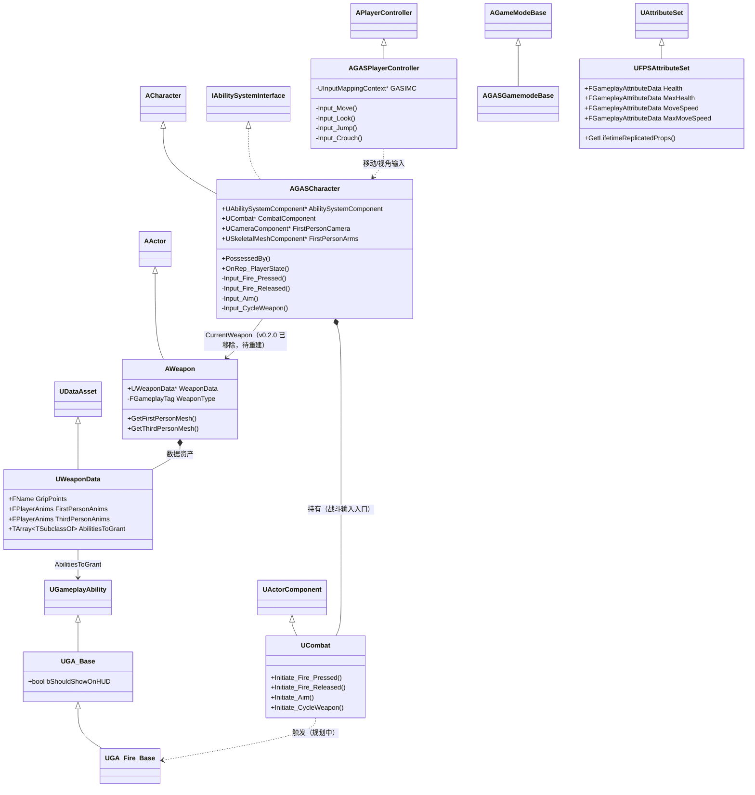

# C++ 类结构图（FPS-v0.2.0 时点）

> 记录 `FPS-v0.2.0` 打版时 `Source/FPS` 的类结构与关系。后续版本结构变化时更新或另存新文件。

## 说明

- **输入分层**：`AGASPlayerController` 只负责移动 / 视角 / 跳跃 / 蹲伏；战斗输入（开火 / 瞄准 / 切枪）绑定在 `AGASCharacter::SetupPlayerInputComponent`，转发给 `UCombat` 组件的 `Initiate_*` 入口（当前为调试桩，v0.2.0 时点未接 GA）。
- **能力体系**：`UGA_Base`（原 `UGASGameplayAbilityBase` 迁移重命名）为全部能力基类；`UGA_Fire_Base` 是开火能力基类，空壳待实现。蓝图能力（`GA_Aim` / `GA_Heal` / `GA_SpawnBlock`）继承关系未画入本图。
- **属性体系**：`UFPSAttributeSet` 只保留角色固有属性（血量 / 移速）；弹药按方案 A 归属武器，本版本尚未在 `AWeapon` / `UWeaponData` 上落地字段。
